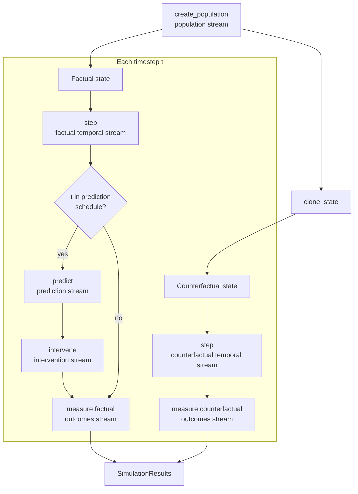

# Algorithm Description Document

**Healthcare Intervention Simulation SDK**

| | |
|---|---|
| Document | Algorithm Description Document (ADD) |
| Version | 0.3, issues register remediated |
| Date | 16 October 2026 |
| Code baseline | `main` at commit `3b94187`, which includes PR #5 (label-free model scores). "Before PR #5" means `main` at `648c56c`. |
| Companion notebooks | All 14 existing notebooks repaired and executed in CI. Additional proposed teaching notebooks remain future work (Section 15). |
| Status of numbers | Numbers in worked examples were produced by running the SDK at the baseline above. Numbers quoted from a docstring or a report say so. The notebooks in Section 15 will reproduce each measured number. |

| Version | Change |
|---|---|
| 0.1 | First draft. |
| 0.2 | Corrections after an independent re-run of every check. Main changes: the silent classification-mode path and the stroke default (I-25); Tier 2's null-regime alarms reinterpreted as a real trend (§12.4, I-04); the ITS example re-run with matched estimands (§11.5); the closed-form ceiling for Beta populations (§8.4); broken notebooks (I-26); hook and test-coverage gaps (§6.5). |

**Reading the evidence.** Sections 3–13 retain the dated defect investigations and
worked examples from the `main@3b94187` baseline. They are historical evidence,
not numerical claims about the corrected implementation. The current behavior is
summarized below and in the resolution column of Section 14. The four reports in
`reports/` have been re-run with the corrected implementation and supersede their
pre-fix versions. All 14 existing notebooks now execute in CI; the *new* teaching
notebooks proposed in Section 15 remain future work.

| Version | Change |
|---|---|
| 0.3 | Remediates I-01–I-29, adds regression/contract checks and notebook CI, separates oracle from observed monitoring, and replaces pre-fix reports. Historical worked examples remain tied to their original baseline. |

### Current implementation after the register fixes

- **Coupling and state:** fixed-size SOC priorities and overbooking coins retain
  temporal/outcomes alignment. Every concrete scenario is tested for both stream
  position and BRANCHED-versus-NONE identity. No-show operations copy input state.
- **Lifecycle:** engine reuse of any scenario object raises. Fresh population
  creation resets sepsis-family model/fatigue caches. NONE and SNAPSHOT work for
  nurse retention; SNAPSHOT remains an explicitly uncoupled legacy mode.
- **Models:** sepsis-family, no-show and nurse-retention fits use larger independent
  reference cohorts, with horizon-specific labels. Unused arguments raise; refits
  recompute empirical prevalence. Infeasible classification fits retain the
  configured requirement, warn, and verify delivered PPV/sensitivity. Stroke's
  unreachable legacy defaults now raise unless explicitly overridden.
- **Measurement:** named exports resolve secondary outcomes or raise. Panel
  treatment follows entity IDs and each entity's own first assignment, including
  lagged appointment outcomes. Sepsis-family `incident_onset` separates new cases
  from the patient-time measured by occupancy `events`.
- **Monitoring:** Tier 2 charts observed-minus-predicted departures and its limits
  are calibrated on separate seeds. Tier 3 defaults to an independent observed
  control in the validation runner; oracle mode is labeled and uses paired
  difference-series inference. Tier 4 uses mature factual outcomes, with a
  separately labeled oracle comparison, logistic recalibration, a pooled baseline
  of at least 100 events, and an explicit evaluation cadence.
- **Scenario semantics:** MASAI uses a score percentile for routing. Manz's
  high-risk nudge uses the model-selected patients; clinical risk determines
  standard-care rates and clinician-level spillover remains explicit.
- **Documentation and verification:** `AR1Process` is deprecated in favor of a
  functional update; the AR(1) seasonal transfer and seed-42 default are documented.
  Static hooks cover imports/aliases and state attribute/subscript access; tests
  cover behavior. Epic ESM verification raises on failed checks.

---

## Contents

1. [Scope](#1-scope)
2. [System overview](#2-system-overview)
3. [A1. Random number stream partitioning](#3-a1-random-number-stream-partitioning)
4. [A2. State representation and cloning](#4-a2-state-representation-and-cloning)
5. [A3. Branched counterfactual engine and coupling](#5-a3-branched-counterfactual-engine-and-coupling)
6. [A4. Step purity and draw-count invariance](#6-a4-step-purity-and-draw-count-invariance)
7. [A5. Population, event rates and temporal dynamics](#7-a5-population-event-rates-and-temporal-dynamics)
8. [A6. Controlled ML model simulation](#8-a6-controlled-ml-model-simulation)
9. [A7. Intervention impact](#9-a7-intervention-impact)
10. [A8. Outcomes, estimands and uncertainty](#10-a8-outcomes-estimands-and-uncertainty)
11. [A9. Evaluation design by simulation](#11-a9-evaluation-design-by-simulation)
12. [A10. Monitoring design: control charts](#12-a10-monitoring-design-control-charts)
13. [A11. Verification pillars](#13-a11-verification-pillars)
14. [Issues register](#14-issues-register)
15. [Companion notebooks](#15-companion-notebooks)
16. [Design principles this document adds](#16-design-principles-this-document-adds)
17. [References](#17-references)

---

## 1. Scope

### 1.1 Purpose

This document describes the algorithms inside the SDK precisely enough that a reader could re-implement them, test them, and know their limits. `docs/design_principles.md` explains why the SDK is built the way it is. This document explains how each part works, what it assumes, how it is verified, and where it currently falls short.

Each algorithm chapter follows the same template:

| Part | Content |
|---|---|
| Need | The problem the algorithm solves and what goes wrong without it |
| Inputs and outputs | What the algorithm consumes and produces |
| Method | The mathematics |
| Procedure | Step-by-step logic, matching the code |
| Assumptions and limits | What must hold for the output to be valid |
| Verification | How correctness is checked today, and gaps |
| Worked example | Numbers produced by running the SDK |
| Implementation | Files and functions |
| Open issues | Links to the issues register (Section 14) |

### 1.2 Audience

Analysts who configure scenarios and interpret results, developers who write scenarios, and reviewers who need to judge whether a result can be trusted.

### 1.3 Critical review of the historical baseline

This document was written alongside a critical read of the code. Problems found are recorded in Section 14, with the evidence and a proposed fix for each. Several of them affect reported results. The most important are:

- The stroke scenario's default model flags almost nobody, and nothing says so. In classification mode with `allow_infeasible`, an unreachable AUC target is silently replaced by the population ceiling (I-25).
- Two scenarios break the coupling between the factual and counterfactual branches partway through a run (I-01).
- The monitoring validation's null-regime claims do not hold (I-04, I-05, I-06). Tier 2's null alarms detect a real decline in turnover, caused by the closed cohort, not chance.
- Re-running a scenario object silently decouples its branches (I-03).
- Most existing notebooks fail at their first import (I-26).

### 1.4 Related documents

| Document | Relationship |
|---|---|
| `docs/design_principles.md` | Rationale. This document supersedes its "Core Mechanisms" section on points of detail. |
| `docs/analytical_first_pass.md` | Closed-form screening that should precede any simulation. Section 9.6 links to it. |
| `.claude/agents/sim-guide.md` | Agent protocol, including the verification checklist that Section 13 formalizes. |
| `.claude/invariants.yaml` | Machine-readable invariants. Section 6.5 states which ones are actually enforced. |

### 1.5 Notation

| Symbol | Meaning |
|---|---|
| $i$ | Entity index (patient, nurse, appointment slot) |
| $t$ | Timestep index, $t = 0, \dots, T-1$ |
| $\Delta$ | Timestep length in years (`TimeConfig.timestep_duration`) |
| $r_i$ | Entity's annual risk (probability of the event within one year) |
| $h_i$ | Hazard rate, per year |
| $p_{i,t}$ | Probability of the event in timestep $t$ |
| $p$ | Prevalence or mean risk in the population |
| $F$, $C$ | Factual branch (AI deployed) and counterfactual branch (no AI) |
| $Y^F_{i,t}$, $Y^C_{i,t}$ | Outcome of entity $i$ at time $t$ on each branch |
| $U$ | A standard uniform random variable |
| $\Phi$, $\Phi^{-1}$ | Standard normal CDF and its inverse |
| $\sigma(x)$ | Logistic function $1/(1+e^{-x})$ |
| AUC | Area under the ROC curve |
| PPV | Positive predictive value, $P(Y=1 \mid \text{flag})$ |
| sens | Sensitivity, $P(\text{flag} \mid Y=1)$ |
| FPR | False positive rate, $1-\text{specificity}$ |

---

## 2. System overview

### 2.1 The problem

When a model flags a patient and a clinician acts, a good outcome hides the evidence. Nobody observes what would have happened without the flag. The SDK builds a synthetic population in which both worlds are computed: one with the AI deployed and one without it. The difference between them is the true effect, known exactly. That known effect is used to answer pre-deployment questions:

- How good must the model be?
- How much staff capacity is needed?
- Will a planned evaluation detect the effect?
- Will a monitoring plan raise false alarms?

### 2.2 Processing chain



The counterfactual branch never calls `predict()` or `intervene()`. It answers one question: what happens without the AI, with standard care still in place.

### 2.3 Algorithm inventory

| ID | Algorithm | Main code | Existing notebook |
|---|---|---|---|
| A1 | Random number stream partitioning | `core/rng.py` | 01 |
| A2 | State representation and cloning | `core/scenario.py` (`clone_state`) | 02 |
| A3 | Branched counterfactual engine and coupling | `core/engine.py` | 03 |
| A4 | Step purity and draw-count invariance | `core/scenario.py` contract, `tests/integration/test_step_purity.py` | 04 |
| A5 | Population, event rates, temporal dynamics | `population/risk_distributions.py`, `population/temporal_dynamics.py` | none |
| A6 | Controlled ML model simulation | `ml/model.py`, `ml/performance.py`, `ml/probability_model.py` | 05 and 06 cover legacy classes only |
| A7 | Intervention impact | Each scenario's `intervene()` and `step()` | 08, 09 (partial) |
| A8 | Outcomes, estimands, uncertainty | `core/results.py`, scenario `measure()` | 07 |
| A9 | Evaluation design by simulation | `experiments/analysis/its.py`, malnutrition `power_map.py` | `its_estimator_demonstration` |
| A10 | Monitoring design: control charts | `scenarios/nurse_retention/monitoring/` | none |
| A11 | Verification pillars | `tests/`, scenario verification runners | `sanity_checks` (partial) |

Twelve of the fourteen notebooks in `examples/` fail at their first import. They use the package's old layout (`sdk.*`, `scenarios.*`, `experiments.*`). Only `02_state_and_clone` and `its_estimator_demonstration` import cleanly (I-26). Where this document says a notebook "demonstrates" something, it means once the imports are repaired.

---

## 3. A1. Random number stream partitioning

### 3.1 Need

A simulation must be reproducible: the same seed gives the same result. A branched simulation also needs something stronger. Random draws that represent the same real-world event must line up across the two branches. If the factual branch's model-noise draws advanced the same generator that drives disease progression, the counterfactual branch (which makes no model draws) would see different disease progression. The difference between branches would then mix the AI's effect with arbitrary noise.

### 3.2 Inputs and outputs

- Input: one integer master seed.
- Output: five independent generators, one per process.

### 3.3 Method

`RNGPartitioner` wraps `numpy.random.SeedSequence(master_seed)` and spawns five child sequences, one per stream name. Each child seeds its own `numpy.random.Generator` (PCG64). `SeedSequence` guarantees that children are statistically independent and reproducible.

`fork()` builds a new `SeedSequence` from the same master seed. Its first spawn yields children with the same entropy as the original partitioner's first spawn, so the forked generators start in exactly the same states as the original ones did. They are separate objects, so consuming one does not move the other.

### 3.4 Stream assignment

| Stream | Used by | Runs on | Must stay synchronized across branches? |
|---|---|---|---|
| `population` | `create_population` | Once, before cloning | No. The counterfactual branch receives a clone and never draws. |
| `temporal` | `step` | Both branches | **Yes** |
| `prediction` | `predict` | Factual only | No |
| `intervention` | `intervene` | Factual only | No |
| `outcomes` | `measure` | Both branches | **Yes** |

Only the two shared streams need synchronization. Factual-only streams may consume any number of draws.

### 3.5 Procedure

1. `BaseScenario.__init__` creates `RNGPartitioner(seed)` and calls `create_streams()` once. The result is stored as `self.rng`.
2. At the start of a branched run, the engine calls `create_population` using the factual streams, then clones the state.
3. The engine calls `self._partitioner.fork().create_streams()` to get the counterfactual streams.
4. Before each hook call, the engine sets `scenario.rng` to the stream set of the branch it is about to run.

Scenario code must therefore read `self.rng.<stream>` inside each method call. Caching a generator on `self` at construction time would bypass the swap. No scenario currently does this.

### 3.6 Assumptions and limits

- The partitioner must spawn exactly once before forking. A second `create_streams()` on the same partitioner yields different children. No code does this today.
- `seed=None` becomes seed 42, not a fresh random seed (I-19).
- Re-running the same scenario object breaks synchronization (I-03, below).

### 3.7 Verification

Notebook 01 demonstrates reproducibility, stream independence, cross-stream correlation near zero, and fork equivalence. It fails at its first import today (I-26), so none of this is checked until it is repaired. Synchronization across a real run is not tested anywhere. Section 5.6 proposes a stream-position audit that would test it.

### 3.8 Worked example: re-running a scenario object

A stroke scenario at zero intervention effectiveness must produce identical factual and counterfactual outcomes, because the AI changes nothing. Run with seed 7 and 2,000 patients for 26 weeks:

| Run | Entity-weeks where factual ≠ counterfactual | Factual identical to a fresh object's run? |
|---|---|---|
| First `engine.run()` | 0 | Yes |
| Second `engine.run()` on the same scenario object | 118 | No |

On the second run, the factual branch keeps using streams already consumed by the first run, while the engine forks fresh counterfactual streams from the master seed. The branches start out of step. No current runner re-uses a scenario object, so no reported result is affected. Nothing prevents it, though, and notebooks or sweeps could easily do it.

### 3.9 Implementation

`healthcare_sim_sdk/core/rng.py` (`RNGStreams`, `RNGPartitioner.create_streams`, `RNGPartitioner.fork`); `core/engine.py` lines 73–113.

### 3.10 Register references

I-03, I-19.

---

## 4. A2. State representation and cloning

### 4.1 Need

The counterfactual branch must evolve its own copy of the population. If the two branches shared mutable objects, an intervention on one branch would leak into the other. The engine must also work with any state shape: a NumPy array for sepsis, nested dataclasses for no-show clinics.

### 4.2 Method

State is a generic type `S`. The engine never inspects it. `BaseScenario.clone_state(state)` returns an independent copy. The default is `copy.deepcopy`. Array-backed scenarios override it with `state.copy()`, which is faster and sufficient.

Cloning happens:

- once, right after `create_population`, in BRANCHED mode;
- once per prediction timestep, before `intervene`, in SNAPSHOT mode.

### 4.3 Rules for scenario authors

1. Every quantity that evolves during a run belongs in `state`. Scenario attributes (`self.*`) hold configuration and caches only.
2. Treat the incoming state as read-only. Copy it first (`new_state = state.copy()`), then modify and return the copy.
3. Any helper object that holds evolving values must live inside the state, not on `self`.

### 4.4 Assumptions and limits

The sepsis family keeps a system-wide alert-fatigue counter on `self._cumulative_false_alerts`. Only `intervene()` reads and writes it, and that runs on the factual branch only, so a single run is correct. The counter is never reset and is not part of the state. A second run on the same object starts with the first run's fatigue (I-14). Fitted-model caches (`self._model_fitted`) behave the same way.

No-show overbooking breaks rule 2. Its `step()` and `intervene()` modify the incoming state in place (`state.day = t`, `state.schedule = ...`). In BRANCHED mode each branch owns its own state object, so no current result is affected. Any caller that keeps a reference to an earlier state, such as a test comparing before and after, sees it change underneath it (I-28).

`AR1Process` in `population/temporal_dynamics.py` stores its current values in `self.current`. A scenario that kept one on `self` and stepped it inside `step()` would share it across both branches. Both branches would advance the same process, which is a purity violation (I-12). No scenario uses the class today. Stroke and sepsis store their AR(1) modifiers in the state array, which is correct.

### 4.5 Verification

Notebook 02 shows mutation isolation for several state types and the speed difference between `deepcopy` and `np.copy`. It is one of the two notebooks that import cleanly.

### 4.6 Implementation

`core/scenario.py` (`BaseScenario.clone_state`); overrides in `scenarios/stroke_prevention/scenario.py` and `scenarios/sepsis_early_alert/scenario.py`.

### 4.7 Register references

I-12, I-14, I-28.

---

## 5. A3. Branched counterfactual engine and coupling

### 5.1 Need

The SDK's central claim is that it knows the true effect. That requires a counterfactual trajectory computed from the same population, under the same background randomness, with only the AI removed. Comparing two independent runs would also give an unbiased effect on average, but every comparison would carry the full outcome noise of both runs.

### 5.2 Method

The engine maintains two state trajectories from one shared initial population. At each timestep:

1. `step` on the factual state, with the factual streams.
2. `step` on the counterfactual state, with the counterfactual streams.
3. If $t$ is in the prediction schedule: `predict` then `intervene` on the factual state only.
4. `measure` on both states, each with its own branch's outcomes stream.

Because the two branches' temporal and outcomes streams start in identical states, the $k$-th draw on one branch equals the $k$-th draw on the other. If both branches consume draws in the same order and number, every random event that the AI did not touch resolves the same way on both branches. This is the method of common random numbers.

### 5.3 Why coupling matters: the mathematics

Most outcomes are drawn as $Y = \mathbb{1}[U < p]$. Suppose on one entity-step the factual probability is $p^F$, the counterfactual probability is $p^C$, and $p^F \le p^C$.

With a shared uniform $U$:

$$D = Y^C - Y^F = \mathbb{1}[p^F \le U < p^C] \sim \text{Bernoulli}(p^C - p^F)$$

$$\mathbb{E}[D] = p^C - p^F, \qquad \text{Var}(D) = (p^C - p^F)(1 - p^C + p^F)$$

With independent uniforms, the mean is the same but:

$$\text{Var}(D) = p^C(1-p^C) + p^F(1-p^F)$$

For an untreated entity, $p^F = p^C$. With coupling its contribution to the effect is exactly zero. With independent draws it contributes noise of about $2p$. In a population where few entities are treated, coupling removes almost all of the noise from the effect estimate.

This holds per entity-step while the two state paths agree except for the treatment. Once outcomes feed back into state (an absorbing event such as death or departure), the paths diverge for that entity. Coupling still holds for every other entity.

### 5.4 Counterfactual modes

| Mode | What runs | Counterfactual recorded | Coupled? | Use |
|---|---|---|---|---|
| BRANCHED | Two full trajectories | Every timestep | Yes, if A4 holds | Default for all effect estimates |
| SNAPSHOT | One trajectory; clone before each `intervene`, measure the clone | Prediction timesteps only | **No.** Both `measure` calls draw from the same outcomes stream in sequence, so the clone and the real state use different uniforms. | Legacy. Same-step effects only, no downstream propagation. |
| NONE | One trajectory | Never | Not applicable | Purity testing, and runs where no comparison is needed |

Nurse retention cannot run in NONE or SNAPSHOT mode. The engine calls `validate_results()` at the end of every run, and nurse retention's version reads the counterfactual outcome at the final week, which those modes do not record. The run fails with `KeyError`, which also rules out a purity test (I-27).

### 5.5 Definition of the counterfactual

The counterfactual is "no AI, standard care continues". Standard care must be modeled inside `step()` so that it runs on both branches. The sepsis scenario's baseline clinical detection and nurse retention's standard-of-care check-ins are examples. A counterfactual with no standard care inflates the AI's benefit; `design_principles.md` §6 documents how that happened in the first sepsis scenario.

### 5.6 Verification: what is tested and what is not

| Test | Proves | Does not prove | Status |
|---|---|---|---|
| BRANCHED factual = NONE trajectory (`assert_purity`) | The counterfactual branch does not disturb the factual branch | That the branches stay coupled | Exists for stroke, sepsis, both no-show scenarios, malnutrition. None for the seven paper replications or nurse retention. |
| Zero-effect identity: effectiveness = 0 ⇒ factual ≡ counterfactual | The intervention is the only source of difference **when it changes nothing** | Coupling once the intervention does change state | Partial: some scenarios, as tests or in notebooks |
| **Stream-position audit** (proposed) | After every step, both branches have consumed the same number of draws from the shared streams | — | Not implemented. Proposed in I-01. |
| **Untreated-entity identity** (proposed) | In scenarios without interaction between entities, never-treated entities have identical outcomes on both branches | — | Not implemented |

The audit was run for this document by replaying the engine loop and comparing the bit-generator positions of the two branches after each step:

| Scenario | Temporal stream | Outcomes stream |
|---|---|---|
| Stroke prevention | Coupled for all 52 steps | Coupled |
| Sepsis early alert | Coupled for all 42 steps | Not drawn |
| Epic ESM (paper 01) | Coupled for all 84 steps | Not drawn |
| No-show targeted reminders | Coupled for all 30 steps | Not drawn |
| **Nurse retention** | **Decouples between week 2 and week 5**, depending on seed (week 2 at seed 1000, week 4 at seeds 1 and 42, week 5 at seed 7) | Not drawn |
| **No-show overbooking** | **Decouples at day 1** | Not drawn |

"Not drawn" means the scenario's `measure()` takes no random draws, so the outcomes column is a real test only for stroke. Nurse retention's module docstring says `measure()` uses the outcomes stream; the code does not. Section 6 explains the two decouplings.

### 5.7 Worked example: coupling and ground truth

Stroke scenario, 5,000 patients, 52 weeks, intervention effectiveness 0.5, treatment threshold 0.005 on the calibrated score, seed 3.

**Expected versus realized effect.** Because both branches' event probabilities are known at every step, the expected number of events prevented can be computed exactly as $\sum_{i,t} (p^C_{i,t} - p^F_{i,t})$.

| Quantity | Value |
|---|---|
| Expected events prevented | 84.9 |
| Realized events prevented (one run) | 72 |
| Patients ever treated | 902 |
| Patients whose outcome differs between branches | 67 |
| Untreated patients whose outcome differs | **0** |

The zero in the last row is coupling working as designed. Only treated patients can contribute to the effect.

**Variance reduction.** The same population and model, with 200 replicates that vary only the outcome draws:

| Design | Mean events prevented | Standard deviation |
|---|---|---|
| Coupled (shared outcome draws) | 84.9 | 9.6 |
| Decoupled (independent outcome draws per branch) | 86.9 | 20.6 |

The coupled mean matches the expected 84.9. Its standard deviation is close to the theoretical floor $\sqrt{84.9} = 9.2$. Variance ratio: 4.6. To reach the coupled design's precision, a decoupled design would need about 4.6 times as many replicates.

### 5.8 Implementation

`core/engine.py` (`BranchedSimulationEngine._run_branched`, `_run_snapshot`, `_run_simple`).

### 5.9 Register references

I-01, I-02, I-03, I-13, I-27.

---

## 6. A4. Step purity and draw-count invariance

### 6.1 Need

Coupling (Section 5) only works if each branch's `step()` and `measure()` depend on nothing except their own inputs, and consume the shared streams identically. Two separate conditions are needed. The SDK currently states only the first.

### 6.2 Condition 1: purity

`step(state, t)` must be a function of `state`, `t`, and the temporal stream only:

- no reads of mutable scenario attributes;
- no writes to anything except the returned state;
- no draws from any other stream.

Reading immutable configuration from `self` is allowed. A time-varying parameter is allowed if its value is a pure function of `t`; `TimeVaryingParameter.value_at(t)` in nurse retention is an example.

### 6.3 Condition 2: draw-count invariance

**The number of draws `step()` and `measure()` take from a shared stream must not depend on state.**

A function can be pure and still violate this. For example, `rng.random(n_active)` is a pure function of state, but `n_active` differs between branches once the AI has changed who is active. From that point on, the two branches read from different positions in the stream. Every later random event on the counterfactual branch is drawn independently of its factual counterpart.

Effects stay unbiased, because each branch is still a valid sample path. What is lost is the pairing. Effect estimates become as noisy as two independent runs, and per-entity comparisons stop meaning anything.

Safe patterns:

| Need | Unsafe | Safe |
|---|---|---|
| Random draw per eligible entity | `rng.random(mask.sum())` | `u = rng.random(n)` then use `u[mask]` |
| Random order within a group | `rng.permutation(group)` | `u = rng.random(n)` once per step, then `group[np.argsort(u[group])]` |
| Conditional extra draw | `if overbooked: rng.random()` | Draw for every slot, use only where needed |
| Outcome for an entity that must pair exactly across branches | Draw at measure time | Draw a per-entity coin at population creation and store it in state (as malnutrition does) |

The last pattern is the strongest. A coin drawn once at creation and stored in state makes the pairing independent of any stream position.

### 6.4 Historical violations (fixed in version 0.3)

**Nurse retention.** Standard-of-care allocation runs in `step()`, on both branches. For each manager, it shuffles eligible nurses with `rng.permutation(new_hires)` and `rng.permutation(others)`, and draws `rng.random(1)` when a team is empty. Team sizes depend on who has departed and who is in cooldown, which differs between branches once AI check-ins take effect. The code comment says "fixed RNG consumption"; that is not true. The audit shows the temporal stream decoupling between week 2 and week 5, depending on the seed. All later departures are drawn independently on the two branches.

**No-show overbooking.** `step()` draws two extra variates (`rng.normal` and `rng.random`) for each overbooked slot. Only the factual branch has overbooked slots, so the temporal stream decouples at day 1. The problem is larger than independent show-up draws, because `step()` also draws the next day's schedule from the temporal stream. From day 2 on, the two branches book different patients into the same slots. With seed 42 and 1,000 patients, slot-to-patient agreement between the branches is 100% on days 0 and 1 and 0% from day 2. Any per-slot or per-patient contrast, including the burden and equity analyses, compares different appointments. Aggregate effects stay unbiased, because each branch is still a valid sample path.

### 6.5 Enforcement at the historical baseline (superseded below)

| Invariant (from `invariants.yaml`) | Enforced by | Gap |
|---|---|---|
| Five abstract methods | `scripts/check_invariants.py` (AST) | None |
| Five stream names | `check_invariants.py` | None |
| No bare `np.random` | `check_no_bare_random.py` | The patterns need a dot after `random`, so `from numpy.random import default_rng` and `import numpy.random as npr` both pass. The hook also exempts `scripts/validate_its_estimator.py`, which `invariants.yaml` does not list. |
| No stdlib `import random` | Nothing | Banned in `invariants.yaml`; the hook's patterns cover NumPy only |
| Engine does not inspect state | `check_invariants.py`: catches `getattr`, `isinstance`, `hasattr` on state variables | `invariants.yaml` also forbids subscript and attribute access; those are not checked |
| Counterfactual branch never calls `predict` | Code structure only | No automated check |
| Step purity | Per-scenario identity tests | Eight scenarios have no test: the seven paper replications and nurse retention. `design_principles.md` calls purity "machine-enforced"; it is test-enforced where tests exist. |
| Draw-count invariance | Nothing | Not stated in any document before this one |

### 6.6 Verification

Notebook 04 demonstrates the purity test and what happens when purity or stream discipline is violated, once its imports are repaired (I-26). It does not cover draw-count invariance. Section 15 adds that.

### 6.7 Register references

I-01, I-02, I-12, I-17, I-22.

---

## 7. A5. Population, event rates and temporal dynamics

### 7.1 Need

Targeting only has value if risk varies across people. The shape of the risk distribution determines how many events the highest-risk patients carry, how well any model can rank patients (the Bayes ceiling, Section 8.4), and how many patients a fixed capacity can reach. Event rates must also convert correctly between the time scales used in configuration (annual risk) and in simulation (per-step probability).

### 7.2 Method: heterogeneous risk

`beta_distributed_risks(n, p, α, rng)` draws

$$r_i \sim \text{Beta}\!\left(\alpha,\ \alpha\left(\tfrac{1}{p} - 1\right)\right)$$

which has mean $p$ and variance

$$\text{Var}(r) = \frac{p^2 (1-p)}{\alpha + p}.$$

It then rescales the sample to have mean exactly $p$ and clips values at 0.99.

The parameter called `concentration` is the Beta $\alpha$, not the Beta precision $\alpha + \beta$. **Lower concentration means more spread.** Most patients then have very low risk and a few have very high risk.

The rescaling removes sampling error in the mean. If clipping binds, the realized mean falls slightly below $p$. At $p = 0.05$ and concentration ≥ 0.3, no values reach the clip.

### 7.3 Worked example: what concentration does

Annual risk $p = 0.05$, 200,000 patients, seed 2026. The Bayes ceiling (Section 8.4) is computed with one-year outcomes drawn from each patient's risk.

| Concentration $\alpha$ | SD of risk | 10th pct | Median | 90th pct | 99th pct | Expected events in the top 10% | Bayes ceiling |
|---|---|---|---|---|---|---|---|
| 4.0 | 0.024 | 0.022 | 0.046 | 0.083 | 0.122 | 20% | 0.643 |
| 1.0 | 0.048 | 0.0056 | 0.036 | 0.114 | 0.216 | 32% | 0.752 |
| 0.5 | 0.066 | 0.0009 | 0.024 | 0.136 | 0.303 | 42% | 0.828 |
| 0.3 | 0.082 | 0.00006 | 0.013 | 0.153 | 0.388 | 51% | 0.874 |

Reading the table: at concentration 4.0, patients' risks are similar. The riskiest tenth of patients carry only 20% of events, and no model can exceed AUC 0.64. At concentration 0.3, the riskiest tenth carry half of all events and the ceiling is 0.87.

**Concentration must be chosen to match the AUC the scenario claims.** SHIELD-RT configures the published AUC of 0.81 on a Beta(2, 7) population. That population's ceiling is about 0.70, so the configuration asks for more than the population can support.

### 7.4 Method: converting risk to per-step probability

Annual risk is converted under a constant-hazard assumption:

$$h_i = -\ln(1 - r_i), \qquad p_{i,t} = 1 - e^{-h_i \Delta}$$

Composing the step probability back over a year recovers the annual risk exactly: $1 - (1-p_{i,t})^{1/\Delta} = r_i$.

Worked example, annual risk 5%, weekly steps ($\Delta = 1/52$):

| Quantity | Value |
|---|---|
| Hazard $h$ | 0.05129 per year |
| Weekly probability $1 - e^{-h/52}$ | 0.000986 |
| Naive weekly probability $0.05/52$ | 0.000962 (2.5% too low) |
| Weekly probability composed over 52 weeks | 0.0500 |

Model labels use the same conversion with $\Delta$ equal to the label window. Stroke, for example, predicts strokes within a four-week window, so its labels use $\Delta = 4/52$.

### 7.5 Method: temporal risk variation (AR(1))

Each entity's risk is scaled by a modifier $X_{i,t}$ that follows

$$X_{i,t} = \rho\, X_{i,t-1} + (1-\rho)\,\mu_t + \varepsilon_{i,t}, \qquad \varepsilon_{i,t} \sim N(0, \sigma^2)$$

clipped to $[0.5, 2.0]$. The current risk is $r_i \cdot X_{i,t}$ multiplied by any demographic or treatment factors.

Without clipping and with constant $\mu$, the stationary mean is $\mu$, the stationary standard deviation is $\sigma / \sqrt{1-\rho^2}$, and the lag-1 autocorrelation is $\rho$.

Simulated check, 20,000 entities, 200 burn-in steps then 200 measured steps:

| $\rho$ | $\sigma$ | Theoretical SD | Simulated SD | Simulated lag-1 autocorrelation | Share of values at a bound |
|---|---|---|---|---|---|
| 0.90 | 0.10 | 0.229 | 0.223 | 0.881 | 0.90% |
| 0.95 | 0.05 | 0.160 | 0.160 | 0.931 | 0.05% |

Clipping trims the SD slightly at $\rho = 0.9$. The simulated autocorrelations sit below $\rho$ because sample autocorrelation over a 200-step series is biased low by roughly $(1 + 3\rho)/T$: 0.019 at both settings, which accounts for the gap.

### 7.6 Seasonality: the parameter is not the realized amplitude

Stroke (and `AR1Process.step_with_season`) adds seasonality by moving the AR(1) target: $\mu_t = 1 + A\cos(2\pi t / P)$. The AR(1) process smooths this forcing. In steady state, the modifier's seasonal swing has amplitude

$$A \cdot \frac{1-\rho}{\left|1 - \rho\, e^{-i\omega}\right|}, \qquad \omega = 2\pi / P$$

and lags the forcing by $\arg(1 - \rho e^{-i\omega}) / \omega$ timesteps.

For stroke's defaults ($A = 0.1$, $\rho = 0.95$, $P = 52$ weeks), the realized seasonal swing is **±3.9%, not ±10%**, and it peaks **9 weeks** after the configured peak. Simulation confirms both numbers. A user who sets `seasonal_amplitude=0.1` expecting ±10% gets less than half of it (I-11).

### 7.7 Outcome types

Scenarios record two different kinds of outcome in `Outcomes.events`, and they mean different things when summed over time.

| Type | Example | `events[i]` at time $t$ means | Sum over $t$ means |
|---|---|---|---|
| Incident event | Stroke: 1 if a stroke occurred this week | A new event | Number of events |
| State occupancy | Sepsis family: 1 if the patient is in sepsis or worse at $t$ | Being in a state | Patient-time spent in the state |

Effect summaries that sum `events` over time measure different things in different scenarios. The sepsis family's "events prevented" is patient-time in sepsis prevented, not cases prevented (I-10). Each scenario should document what `events` means.

### 7.8 Verification

The bulletproof statistical-sanity tests check beta means within 4-sigma CLT bounds, variance ordering by concentration, hazard round-trips, and AR(1) stationary mean, variance and autocorrelation. No test checks the seasonal response.

### 7.9 Implementation

`population/risk_distributions.py` (`beta_distributed_risks`); `population/temporal_dynamics.py` (`annual_risk_to_hazard`, `hazard_to_timestep_probability`, `AR1Process`); AR(1) state rows in `scenarios/stroke_prevention/scenario.py` and `scenarios/sepsis_early_alert/scenario.py`.

### 7.10 Register references

I-10, I-11, I-12.

---

## 8. A6. Controlled ML model simulation

### 8.1 Need

Pre-deployment questions take the form "what if the model achieves AUC 0.82 here?" Training a real model would answer a different question. The SDK instead generates scores whose performance matches a specification. That specification must be achievable on the synthetic population, and the scores must behave like a real model's scores: calibrated, and with no knowledge of the outcome.

### 8.2 How the metrics are linked

At prevalence $p$:

$$\text{PPV} = \frac{\text{sens}\cdot p}{\text{sens}\cdot p + \text{FPR}\cdot(1-p)} \qquad \text{(Bayes' theorem)}$$

The SDK models the ROC curve as equal-variance binormal:

$$\text{sens} = \Phi\!\left(\Phi^{-1}(\text{FPR}) + d'\right), \qquad d' = \sqrt{2}\;\Phi^{-1}(\text{AUC})$$

Holding PPV fixed defines a straight line through the origin of ROC space:

$$\text{FPR} = k\cdot\text{sens}, \qquad k = \frac{p\,(1-\text{PPV})}{\text{PPV}\,(1-p)}$$

The curve crosses that line once. Consequence: **at fixed prevalence, any two of AUC, PPV and sensitivity determine the third.** Specifying all three overdetermines the model.

PPV plus sensitivity gives the AUC required, in closed form:

$$\text{FPR} = k \cdot \text{sens}, \qquad \text{AUC}_{\text{req}} = \Phi\!\left(\frac{\Phi^{-1}(\text{sens}) - \Phi^{-1}(\text{FPR})}{\sqrt{2}}\right)$$

A PPV at or below prevalence describes a model worse than random and is rejected.

### 8.3 Worked examples from the SDK's functions

| Prevalence | Given | Result |
|---|---|---|
| 5% | AUC 0.80, PPV 0.20 | Sensitivity 0.453 |
| 5% | AUC 0.80, sensitivity 0.50 | PPV 0.184 |
| 13% | PPV 0.25, sensitivity 0.80 | AUC needed 0.803 |
| 5% | PPV 0.30, sensitivity 0.70 | AUC needed 0.909 |
| 0.41% (stroke, expected 4-week rate) | PPV 0.15, sensitivity 0.80 | AUC needed **0.981** |

Stroke's realized fit populations vary around the expected rate: 0.37% to 0.49% across six seeds at 20,000 patients, needing AUC 0.978 to 0.982. Version 0.1 quoted 0.55% from one sample, which needs 0.976. The ceiling on those six populations is 0.78 to 0.84.

The binormal model is an approximation. The docstrings in `ml/performance.py` document its error on the SDK's beta populations (quoted here, not re-measured): sensitivity error 0.004–0.011 at AUC ≥ 0.83, rising to about 0.09 near AUC 0.68. That is accurate enough to judge feasibility. The fitted model is always judged on its actual output.

### 8.4 The Bayes ceiling

Outcomes are random draws from each entity's risk. Even an oracle that scores every entity by its true risk cannot rank outcomes perfectly. A patient at 2% risk sometimes has the event, and a patient at 30% risk usually does not. The oracle's AUC, true risk scored against realized outcomes, is the population's **Bayes ceiling**. Within the simulation, true risk is all there is to know before the draw, so no model without access to the outcome can exceed it.

The ceiling is estimated from a finite sample. Its standard error follows Hanley and McNeil (1982):

$$\text{SE}^2 = \frac{A(1-A) + (n_1 - 1)(Q_1 - A^2) + (n_0 - 1)(Q_2 - A^2)}{n_1 n_0}, \quad Q_1 = \frac{A}{2-A}, \quad Q_2 = \frac{2A^2}{1+A}$$

where $A$ is the estimated ceiling and $n_1$, $n_0$ are the numbers of positives and negatives.

**What sets the ceiling: risk spread.** The ceiling depends mainly on how much true risk varies between entities, and only weakly on the event rate. "Spread" means the spread of the risk distribution in Section 7.2, controlled by the Beta's first shape parameter $\alpha$ (the `concentration` argument). Lower $\alpha$ means more spread. If every entity had the same risk, no ranking could separate outcomes and the ceiling would be 0.5.

**Closed form for Beta populations.** Let $r \sim \text{Beta}(\alpha, \beta)$ and $Y \mid r \sim \text{Bernoulli}(r)$. Conditioning on the outcome multiplies the density by $r$ or by $1-r$, so the risks of entities with and without the event are again Beta:

$$r \mid Y{=}1 \;\sim\; \text{Beta}(\alpha+1,\ \beta), \qquad r \mid Y{=}0 \;\sim\; \text{Beta}(\alpha,\ \beta+1)$$

The ceiling is the probability that a random entity with the event has a higher true risk than a random entity without it:

$$\text{AUC}^{*} = P(X > Z) = \int_0^1 f_X(x)\, F_Z(x)\, dx, \qquad X \sim \text{Beta}(\alpha+1,\beta),\ \ Z \sim \text{Beta}(\alpha,\beta+1)$$

The less those two distributions overlap, the higher the ceiling. At $p = 0.05$:

| $\alpha$ | Median risk, entities with the event | Median risk, entities without | Ceiling, closed form | Ceiling, simulated (§7.3) |
|---|---|---|---|---|
| 4.0 | 5.8% | 4.6% | 0.640 | 0.643 |
| 1.0 | 8.3% | 3.4% | 0.756 | 0.752 |
| 0.5 | 11.4% | 2.2% | 0.826 | 0.828 |
| 0.3 | 15.5% | 1.1% | 0.875 | 0.874 |

The closed form agrees with simulation within 0.004 here, and also at $\alpha$ = 5, 2, 0.15 and 0.06 at the same event rate. It gives a fast feasibility check before any population is drawn. It assumes one outcome drawn from a fixed risk. When labels cover a window shorter than the risk's horizon, the label probability is close to proportional to $r$ for small risks, and the same result holds approximately. With time-varying risk (AR(1) modifiers), use the empirical ceiling.

It also works in reverse. A model that really reaches AUC 0.85 at a 5% event rate implies, under this family, a population with $\alpha \le 0.39$.

### 8.5 Score generator

For entity $i$ with true risk $r_i$, correlation $c$, noise scale $k$, and standard normal draws $z_{1i}$, $z_{2i}$:

$$x_i = c\cdot r_i + (1-c)\,k\,z_{1i} + 0.1\,k\,z_{2i}, \qquad s_i^{\text{raw}} = \sigma\big(4(x_i - 0.5)\big)$$

The generator sees only $r_i$. It never sees the outcome. `predict()` accepts `true_labels` for backward compatibility and ignores them, so scores are identical with or without labels.

Before PR #5, the generator added a label-dependent shift during fitting. `predict()` dropped it when called without outcomes, which is how 10 of 12 scenarios call it, and kept it when called with them. PR #5 removed the shift; Section 8.10 gives the before/after numbers.

### 8.6 Fitting procedure

```
fit(labels, risks, rng):
  1. ceiling ← exact rank AUC of (labels, risks); n₁ ← number of positives
  2. if labels are all one class: warn, keep defaults, return
  3. AUC_req ← target_auc                       (discrimination, threshold_ppv)
             ← solve(binding, goal)  or target   (operating_point)
             ← AUC implied by (PPV, sens)        (classification)
  4. ceiling gate:
       if AUC_req > ceiling + max(tol, 2·SE):
         if allow_infeasible: do nothing here
         elif n₁ < 30: warn (estimate too noisy to judge)
         else: raise OperatingPointError
     classification with allow_infeasible only:
       if AUC_req > ceiling: AUC_req ← ceiling      (no warning; see I-25)
  5. draws ← max(n_iterations, 5) sets of (z₁, z₂), reused for every candidate
  6. grid search over c ∈ [0.30, 0.99] × k ∈ [0.01, 0.70] (15 × 15):
       minimize |mean AUC over draws − AUC_req|
  7. bisection on k within ± one grid step of the best k (12 iterations, if bracketed)
  8. Platt scaling on one fresh draw: P(y=1|s) = σ(a·logit(s) + b), maximum likelihood
  9. threshold:  operating_point → exact cut on the binding metric (calibrated scale)
                 classification  → exact cut on PPV (calibrated scale)
                 otherwise       → operating_threshold or 0.5
 10. report all metrics on another fresh draw (what predict() will deliver)
 11. gates: operating_point checks binding metric, goal and AUC;
              raises on a miss, or warns if allow_infeasible
            other modes check AUC only, against AUC_req as set in step 4;
              warn on a miss; skipped below 30 positives
```

Step 4 is where classification mode goes wrong. With `allow_infeasible`, an unreachable requirement is replaced by the ceiling before fitting, and the report's `required_auc` shows the ceiling. Step 11 then compares the delivered AUC with the ceiling, which it meets. Nothing records that the configured PPV and sensitivity needed AUC 0.98, and nothing checks the delivered sensitivity. Stroke runs this way by default (I-25).

Using the same draws for every candidate in step 5 (common random numbers, again) means candidates differ only through their parameters, so the search compares signal rather than noise.

### 8.7 Modes

| Mode | You set | The model derives | Use |
|---|---|---|---|
| `discrimination` | AUC | Nothing about the threshold. The scenario picks its own cut (percentile, top-K). | Ranking and capacity-limited targeting. Most scenarios. |
| `operating_point` | One binding metric (PPV or sensitivity) and either AUC or a goal for the other metric | Threshold placed exactly on the binding metric | Alert systems where a threshold matters. Recommended. |
| `classification` (legacy) | PPV and sensitivity | The AUC they imply; threshold placed on PPV | Stroke. Not equivalent to operating_point with a PPV binding: it never checks delivered sensitivity, and with `allow_infeasible` it silently replaces an unreachable AUC with the ceiling (I-25). |
| `threshold_ppv` (legacy) | AUC, PPV and a fixed threshold | Nothing | Overdetermined. AUC is enforced; PPV is reported, not enforced. |

### 8.8 Gates

| Gate | Condition | Action |
|---|---|---|
| Ceiling | Required AUC > ceiling + max(0.02, 2·SE) | Raise; warn instead if fewer than 30 positives. With `allow_infeasible`, nothing happens at fit time. Classification then replaces the requirement with the ceiling, so nothing is reported at all (I-25). |
| Delivered metrics, operating_point | Delivered binding metric, goal or AUC misses tolerance (both directions) | Raise; warn with `allow_infeasible` |
| Delivered metrics, other modes | Delivered AUC misses the required AUC (as set at fit time) | Warn. PPV and sensitivity are never checked. Skipped below 30 positives. |
| Degenerate PPV | PPV ≤ prevalence | Raise |
| Single-class population | No positives or no negatives | Warn, keep defaults, calibration at identity |

### 8.9 Assumptions and limits

- **Scores depend on current risk only.** They have no feature-level structure, no subgroup-specific accuracy, and no knowledge of time to onset. The malnutrition scenario carries its own subgroup-differential scorer. TREWS-style "detects before clinical suspicion" timing is not representable.
- **Models are fit on the population at the first prediction call.** In the sepsis family that population has 9–42 positive patients, because labels mark who is septic at $t = 0$. Nurse retention's has about 18 departures (mean over 30 seeds), and its estimated ceiling ranges from 0.67 to 0.90 across those seeds. A configured AUC cannot be verified on so few events. The gate warns instead of refusing (I-21).
- **A model can satisfy its gates and flag almost nobody.** Stroke's default (classification, PPV 0.15, sensitivity 0.80, `allow_infeasible`) delivered sensitivity 0.00 in five of six seeds at 20,000 patients, with no warning (I-25).
- **Calibration targets the fit population.** If prevalence drifts during a run, the scores stay calibrated to the original population.
- **Arguments a mode does not use are silently ignored** (I-18).
- **A refit on the same model object reuses the first fit's prevalence** (I-18).

### 8.10 Worked example: configured versus delivered AUC

5,000 patients, 5% prevalence, Bayes ceiling 0.91. The model is fit on one population, then scored on an independent one through `predict()` with no labels. Mean of three seeds.

| Configured AUC | Before PR #5, delivered | Before PR #5, outcomes passed in | After PR #5, delivered | Calibration slope, before → after |
|---|---|---|---|---|
| 0.630 | 0.670 | 0.693 | 0.611 | 0.82 → 0.90 |
| 0.720 | 0.685 | 0.705 | 0.702 | 0.84 → 0.94 |
| 0.760 | 0.717 | 0.740 | 0.747 | 0.86 → 0.97 |
| 0.780 | 0.711 | 0.763 | 0.768 | 0.77 → 0.97 |
| 0.810 | 0.768 | 0.794 | 0.803 | 0.87 → 0.99 |
| 0.830 | 0.771 | 0.823 | 0.826 | 0.82 → 0.99 |
| 0.845 | 0.757 | 0.835 | 0.847 | 0.77 → 1.00 |

After PR #5 the largest miss is 0.019. Before it, the fit report agreed with the target to within 0.01 in six of seven rows. (At 0.63 the old search could not reach the target at all.) That agreement is why nobody noticed: the report described a model `predict()` never ran.

### 8.11 Verification

`tests/unit/test_label_free_fidelity.py` (27 tests) scores fresh populations through `predict()` and never relies on the fit report. Run against the code before PR #5, the module does not import, because it uses `auc_exact`, which PR #5 added. With that one function back-ported, 21 of the 27 tests fail. `tests/unit/test_operating_point.py` covers the over- and under-determined configurations and the gate messages.

The one test that runs classification mode with `allow_infeasible` (`test_sanity.py`, PPV ordering across prevalence) checks a different property. No test checks that a replaced requirement is reported, or that classification mode delivers its sensitivity (I-25).

### 8.12 Implementation

`ml/model.py` (`ControlledMLModel`); `ml/performance.py` (`auc_exact`, `required_auc_for_operating_point`, `sensitivity_at_ppv`, `ppv_at_sensitivity`, `validate_operating_point`); `ml/probability_model.py` (`ControlledProbabilityModel`, same principles in log-odds space).

### 8.13 Register references

I-18, I-21, I-25.

---

## 9. A7. Intervention impact

### 9.1 Need

A flag changes nothing by itself. Between the model's score and a changed outcome sit a threshold, a human who may or may not respond, finite staff capacity, a treatment whose benefit depends on timing, and standard care that would have caught some cases anyway. Leaving any of these out overstates benefit. `design_principles.md` records capacity, not AUC, as the binding constraint in the TREWS sweep.

### 9.2 The causal chain

For entity $i$ at a prediction time $t$:

```
score s_i  →  flagged?  →  response?  →  within capacity?  →  treated  →  effect e(τ)  →  hazard reduced
```

| Link | General form | Example |
|---|---|---|
| Flag | $s_i \ge$ threshold; or top percentile among active entities; or top-K | Sepsis: top 10% of active patients |
| Response | Bernoulli with rate $r_t$ | Sepsis: $r_t = \max\!\left(r_{\text{floor}},\ r_0\, e^{-\phi F_t}\right)$, $F_t$ = system-wide cumulative false alerts |
| Capacity | At most $C$ treated per step, highest score first | Sepsis: rapid response capacity per 4-hour block |
| Effect | $h' = h\,(1 - e)$ on the treated entity's hazard or transition probability | Stroke: persistent risk multiplier |
| Effect over time | Permanent, decaying, or timing-dependent | Nurse retention: $e \cdot 2^{-\tau/T_{1/2}}$ per week since check-in. Sepsis (Kumar): $e_{\max}\cdot 0.5^{d / T_{1/2}}$, where $d$ is hours from onset to treatment; treatment before onset gets $e_{\max}$. |
| Standard care | Runs inside `step()` on both branches | Sepsis baseline detection delay drawn per patient; nurse retention standard-of-care check-ins. The effective benefit is $\max(e_{\text{AI}}, e_{\text{SOC}})$. |

### 9.3 Ground truth from the chain

Because every link is explicit, the expected effect is known exactly from the two branches' probabilities (Section 5.7): $\sum_{i,t} (p^C_{i,t} - p^F_{i,t})$. For screening before any simulation, the chain collapses to a product:

$$\text{events prevented} \approx N \cdot p \cdot \text{sens} \cdot r \cdot \kappa \cdot e$$

where $\kappa$ is the share of responded flags that fit within capacity. `docs/analytical_first_pass.md` describes when this product is enough and when the full simulation is needed. Simulation is needed whenever timing, fatigue, capacity queues or score-dependent efficacy matter.

### 9.4 Interference between entities

Capacity makes entities interfere. Treating one patient can use the slot another would have received. Alert fatigue depends on system-wide false alerts. Per-entity effects are therefore not independent, and the stable-unit assumption behind entity-level estimators (for example an entity-level DiD) does not hold. Effects should be estimated at the level where the intervention operates: the unit, the clinic, the time block.

### 9.5 Interventions that do not change risk

Overbooking changes the schedule, not any patient's risk. Its outcomes are operational: collisions, wait time, overtime. The same engine applies; the estimand changes (Section 10).

### 9.6 Assumptions and limits

- Effect size $e$ is an input, usually from literature. The simulation propagates it; it does not validate it.
- Threshold semantics must match the score scale. Scores from `ControlledMLModel` are calibrated probabilities. MASAI uses a fixed cut of 0.70, written to mean "AI score above 7 of 10", but its calibrated scores peak near 0.63, so nobody is routed (I-23).
- A scenario whose outcomes do not depend on the model's scores cannot test the model. Manz decides outcomes from true risk (I-23).
- **Check that anyone is treated.** Stroke's default configuration recorded 2 to 73 treatments among 20,000 patients over a year (six seeds), because its model flags almost nobody (I-25). With `treatment_threshold=0.005` it treats about 900 of 5,000 (§5.7). Every stroke example in this document sets that threshold. In the §11.5 design (20,000 patients, effectiveness 0.5, switch-on at week 26, seed 11), the default prevents about 0.24 expected events per week after switch-on, against 6.6 with the threshold.

### 9.7 Verification

Monotonicity tests in `tests/bulletproof/test_conservation_laws.py` check that higher effectiveness gives fewer events and that a higher threshold gives fewer treated. Zero-effect identity is checked in some scenarios. Capacity is checked in the sepsis conservation tests.

### 9.8 Implementation

Each scenario's `intervene()` and `step()`. Generic pieces worth extracting are listed in `design_principles.md` Appendix B: baseline care, Kumar decay, a capacity helper.

### 9.9 Register references

I-01, I-14, I-23, I-25.

---

## 10. A8. Outcomes, estimands and uncertainty

### 10.1 Need

A result is only interpretable if three things are stated: what was measured, what effect was estimated, and how uncertain it is. Without them, numbers from different scenarios cannot be compared, and a single run looks more certain than it is.

### 10.2 Estimands

Sign convention: benefit is positive, $C - F$. This is the convention the malnutrition scenario uses and states in every caption.

| Estimand | Definition | Needs coupling? |
|---|---|---|
| Total effect | $\sum_{i,t} (Y^C_{i,t} - Y^F_{i,t})$ | No (coupling only reduces its variance) |
| Average effect per entity | Total effect $/ N$ | No |
| Effect on the treated (ATT) | Mean of $\sum_t (Y^C_{i,t} - Y^F_{i,t})$ over entities ever treated | No |
| Per-entity contrast ("rescued", "displaced") | $Y^C_i - Y^F_i$ for individual entities | **Yes.** Without coupling the contrast is mostly noise. |
| Expected effect | $\sum_{i,t} (p^C_{i,t} - p^F_{i,t})$ | No. Computable only inside the simulation. |

Every analysis should state which estimand it reports, what `events` means in the scenario (Section 7.7), and the sign convention.

### 10.3 Two sources of uncertainty

1. **Outcome noise within a population.** Which events happen, given everyone's risk. Coupling reduces it (Section 5.7).
2. **Population variation between seeds.** Which patients the synthetic site happens to have, and how many of them are high-risk. Coupling cannot reduce it. It represents real uncertainty about a site like this one.

From the stroke example:

| Variation | Standard deviation of events prevented |
|---|---|
| Within one population, coupled (200 outcome replicates) | 9.6 |
| Between 30 seeds, coupled (population and outcomes both vary) | 20.6 |

Most of the uncertainty about one site's result comes from which patients it has, not from outcome noise.

**Reporting rule.** Run at least 30 seeds. Report the mean with a confidence interval, $\bar{x} \pm t_{0.975,S-1}\, s/\sqrt{S}$, for "the average site like this". Report the spread, $\bar{x} \pm t_{0.975,S-1}\, s$, for "what one deployment might see". These answer different questions, and the second is usually the one a decision needs.

### 10.4 Analysis exports

`SimulationResults.to_analysis()` returns an `AnalysisDataset` with four exports:

| Export | Shape | Caveat |
|---|---|---|
| `to_time_series()` | Per-step totals of `events` | `treatment_indicator` is 1 at every step with an `intervene()` call, not a post-period indicator. Build the post indicator yourself. |
| `to_panel()` | Entity × step long format | `treated` = ever treated **and** $t \ge$ the first intervention time anywhere in the run. An entity first treated in week 30 is marked treated from the run's first intervention time (week 0 in stroke), not from week 30. It also matches `treated_indices` against entity IDs, which is wrong wherever IDs are not positions: no-show slot IDs are day·10000 + i, while treated indices are schedule positions (I-09). |
| `to_entity_snapshots(t)` | Cross-section at $t$ with scores | For RDD around a threshold |
| `to_subgroup_panel()` | Panel with group labels | Labels from `secondary` or `metadata` |

All four, and `get_outcome_series()`, accept an `outcome_key` argument that is never used. They always return `events`. A request for `"mortality"` silently returns `events` (I-08).

### 10.5 Register references

I-08, I-09, I-10.

---

## 11. A9. Evaluation design by simulation

### 11.1 Need

A real deployment has no counterfactual branch. It is evaluated with quasi-experimental methods: interrupted time series, controlled ITS, difference-in-differences, regression discontinuity, stepped wedge. Each can be biased or underpowered in a given setting. The SDK's most valuable use is to test the planned method on synthetic data where the true effect is known, before committing to it.

### 11.2 The rule that makes this valid: oracle versus observable

| Data | Available in a real deployment? | Role in a design study |
|---|---|---|
| Factual branch outcomes | Yes | Input to the estimator |
| Real comparison units (other sites, wards, time periods) | Sometimes | Input to the estimator |
| Counterfactual branch | **Never** | Ground truth for grading the estimator |
| True risks, true labels, per-entity effects | **Never** | Ground truth and diagnostics |

An estimator that uses the counterfactual branch as its control (`cits_with_control` in its oracle configuration, nurse-retention Tier 3) is a benchmark, not a deployable method. Its performance says nothing about what a real evaluation would achieve.

### 11.3 Procedure

1. **Define the estimand and its truth.** For example: average weekly events prevented in the post period, computed from $C - F$.
2. **Simulate the real deployment schedule.** A pre-period without the AI, then switch-on or a staggered rollout. Use the prediction schedule to control when the AI starts.
3. **Generate $S$ seeds under the alternative** (the planned effectiveness) **and $S$ under the null** (effectiveness 0).
4. **Apply the candidate estimator to observable data only.**
5. **Grade it:**
   - bias = mean(estimate − truth);
   - RMSE;
   - confidence-interval coverage;
   - power = share of alternative seeds with $p < \alpha$ in the expected direction;
   - type I error = share of null seeds with $p < \alpha$.
6. **Sweep the design knobs:** population size, horizon, switch-on time, aggregation level, number of sites.
7. **Choose the smallest design that meets power and type I targets.** Report the design and its operating characteristics.

Sweeps use Hydra YAML grids and `--multirun`, and runners call `finalize_experiment()`, per `CLAUDE.md`.

### 11.4 Estimators available

| Estimator | Code | Notes |
|---|---|---|
| Segmented regression ITS: $Y_t = \beta_0 + \beta_1 t + \beta_2\,\text{post}_t + \beta_3 (t - T^*)\,\text{post}_t + \varepsilon_t$ | `experiments/analysis/its.py` `segmented_regression` | Plain OLS by default; empirical type I 0.0505 at nominal 0.05 on 60-point iid series. Newey–West HAC is anti-conservative in small samples (type I ≈ 0.095 at lag 1, 0.163 at lag 4). |
| Power across seeds | `power_across_seeds` | Counts $p < \alpha$ **and** the expected sign |
| Controlled ITS, stacked groups: $Y = b_0 + b_1 t + b_2 g + b_3 g t$ | `cits_with_control` | With a real control series: deployable. With the counterfactual branch as control: oracle only. Its OLS standard error treats the two series as independent. While the branches are coupled they are positively correlated, so the standard error is conservative. Nurse retention, the only scenario that uses this configuration, decouples by week 2–5 (I-01), so that argument does not apply there (I-15). |
| Slope only | `its_slope_only` | Floor estimator when there is no pre-period or control |
| Difference-in-differences, RDD | Use `to_panel()`, `to_entity_snapshots()` with your own model | Mind the `to_panel` treated definition (I-09) and interference (Section 9.4) |
| Stepped wedge (closed form, Hussey and Hughes 2007) | malnutrition `power_map.py` | A single site cannot identify a stepped wedge; it reduces to ITS |

### 11.5 Worked example: is a one-site, one-year ITS adequate?

Stroke scenario, 52 weekly steps, effectiveness 0.5, treatment threshold 0.005 on the calibrated score (the default flags almost nobody; §9.6). The AI switches on at week 26 (prediction schedule 26, 30, …, 50). Segmented regression on the factual weekly event counts, break at week 26. 40 seeds per cell, the same seeds in every cell.

**Match the estimand first.** In the segmented model, $-\beta_2$ is the drop in level at the break: the effect at switch-on. The mean effect over the post period is $-(\beta_2 + \bar\tau\,\beta_3)$, where $\bar\tau = 12.5$ is the mean of $t - T^*$ over the 26 post weeks. The two are equal only if the effect is a constant step. Here it is not. Treated patients accumulate, so at 20,000 patients the expected effect grows from 5.9 events prevented per week at week 26 to 7.1 at week 38. Each estimate must be graded against its own truth. Both truths are computed from the two branches' event probabilities (§5.7). Version 0.1 compared $-\beta_2$ with the post-period mean and reported part of the difference as bias.

| Population | Effectiveness | True effect at switch-on | True post-period mean | Mean $-\beta_2$ | Share with $p < 0.05$ for $\beta_2$ and $\beta_2 < 0$ |
|---|---|---|---|---|---|
| 5,000 | 0.5 | 1.41 | 1.55 | 1.43 | **22.5%** (power) |
| 5,000 | 0 | 0 | 0 | −0.17 | 2.5% (type I, one-sided) |
| 20,000 | 0.5 | 5.87 | 6.37 | 7.04 | **80.0%** (power) |
| 20,000 | 0 | 0 | 0 | 1.19 | 0.0% (type I, one-sided) |

Effects are expected events prevented per week, $C - F$.

Reading it: at 5,000 patients this design would miss a real effect about four times in five. Reaching 80% power takes about 20,000 patients over one year. Type I error is in range. With 40 seeds, a rate near 80% carries a standard error of about 6 percentage points, so these are design-level answers, not precise ones.

**Bias check against the oracle.** Power and type I error are not enough. The same 40 seeds were run with the scenario's seasonality switched off. Because the seeds are paired, the difference between the two rows of each population isolates the effect of seasonality.

| Population | Seasonality | $-\beta_2$ minus true jump: null (SE) | Alternative (SE) | Post-period estimate minus true mean: null (SE) | Alternative (SE) |
|---|---|---|---|---|---|
| 5,000 | On ($A = 0.1$) | −0.17 (0.22) | +0.02 (0.19) | −0.11 (0.30) | +0.00 (0.29) |
| 5,000 | Off | −0.41 (0.22) | −0.18 (0.20) | −0.18 (0.30) | −0.06 (0.29) |
| 20,000 | On ($A = 0.1$) | **+1.19 (0.29)** | **+1.17 (0.31)** | +1.26 (0.42) | +1.28 (0.41) |
| 20,000 | Off | +0.28 (0.30) | +0.45 (0.31) | +1.08 (0.43) | +1.07 (0.42) |

Reading it:

- **The level change is biased by seasonality.** Seasonality adds about +0.2 spurious events prevented per week at 5,000 patients. At 20,000 it adds +0.9 under the null and +0.7 under the alternative, so it grows roughly in proportion to population. With seasonality on, the bias at 20,000 is about four standard errors from zero in both regimes, and about a fifth of the true jump. At 5,000 it is hidden by noise. The −0.41 at 5,000 is shared seed noise; it appears with and without seasonality.
- **The post-period estimate trades bias for noise.** Seasonality moves it by only about +0.2. But its standard deviation across seeds is 2.7 events per week at 20,000, against 1.9 to 2.1 for $-\beta_2$. Its 20,000-patient rows sit 2.5 to 3 standard errors above zero, with and without seasonality. Forty seeds cannot tell whether that offset is systematic. A study that relies on this estimate needs more seeds.

This happens even though the realized seasonal swing is only ±3.9% (Section 7.6). Type I error stayed near zero because the OLS standard error absorbs the seasonal misfit. A design study that checked only power and type I error would have approved a biased estimator. Checking bias against the oracle caught it, once the estimate and the truth measured the same thing. In a real evaluation the remedies are a seasonal term in the model, a pre-period covering a full cycle, or a concurrent control series.

### 11.6 Relationship to the analytical-first pass

If the design question depends only on point estimates (expected effect, variance of a weekly count), closed-form power is enough and faster. `docs/analytical_first_pass.md` gives the protocol. The simulation is needed when the effect ramps up as treated patients accumulate, when counts are small or autocorrelated, or when the deployment has staggered timing or interference.

---

## 12. A10. Monitoring design: control charts

### 12.1 Need

After deployment, a monitoring plan should detect when the program stops working, without raising so many false alarms that people stop looking. The two properties trade off. A simulation with known regimes (working, null, decaying, capacity collapse) can measure both properties before the plan is adopted.

### 12.2 Methods implemented (nurse retention, `monitoring/`)

| Tier | Method | Statistic and rule |
|---|---|---|
| 1 | Shewhart individuals and moving range (XmR) | $\hat\sigma = \overline{MR}/1.128$; limits $\bar{x} \pm 3\hat\sigma$; WE1 = one point outside the limits; WE2 = 8 consecutive points on one side of the centre line |
| 2 | Two-sided CUSUM (Page 1954) | $C^+_t = \max(0,\ C^+_{t-1} + x_t - \mu_0 - K)$; $C^-_t = \max(0,\ C^-_{t-1} - x_t + \mu_0 - K)$; alarm when either exceeds $H$. $K = 0.5\hat\sigma$, $H = 4\hat\sigma$; $\mu_0$, $\hat\sigma$ from the first 8 weeks. The arm that fires is reset. |
| 3 | Rolling controlled ITS | `cits_with_control` refit quarterly; oracle mode uses the counterfactual branch |
| 4 | Model drift | Rolling 12-week AUC, calibration slope and Brier score, evaluated at each prediction (every 2 weeks). Alarm when AUC < 0.65 at 4 consecutive evaluations (8 weeks, although the code calls them weeks), or when the calibration slope moves more than 20% from its first computable value. The "calibration slope" is an ordinary least-squares fit of 0/1 outcomes on logit(p), not the logistic recalibration slope its docstring describes (I-29). |

### 12.3 The key property: in-control run length

A chart's false alarm behavior is summarized by ARL₀, the average number of steps until a false alarm when nothing has changed. Textbook values assume the in-control mean and standard deviation are known, observations are independent, and the in-control mean is constant. In nurse retention the limits come from 8 baseline weeks, and the in-control mean is not constant (§12.4). Autocorrelation is not the issue there: after removing the trend, lag-1 autocorrelation of weekly turnover is about zero. The table shows how much each assumption matters in general.

Simulated two-sided CUSUM, $k = 0.5$, $h = 4$, 2,000 replicates:

| In-control process | Median run length | Mean run length | Probability of a false alarm within 52 weeks |
|---|---|---|---|
| Independent, parameters known | 124 | 170 | 26% |
| Independent, $\mu_0$ and $\sigma$ estimated from 8 points | 32 | 212 | 60% |
| AR(1) with $\rho = 0.5$, estimated from 8 points | 10 | 23 | **92%** |

The first row matches the textbook ARL₀ of about 168 for this design (Montgomery). The other rows show why estimated limits and autocorrelation matter. The mean in row 2 is high because a few replicates with an overestimated $\sigma$ alarm very late, or not within the 2,000-step horizon.

### 12.4 Why the historical monitoring report was withdrawn

`reports/monitoring_validation/monitoring_validation.md` reports Tier 2 firing in **30 of 30 null-regime seeds, at a median of week 20**. It attributes the firing to "the beneficial effect of the AI", which cannot apply in a regime where the AI has no effect (I-04).

Version 0.1 of this document called these false alarms, caused by estimated limits and autocorrelation. That was wrong. A re-run of the null configuration (seeds 1000–1007) shows what the chart detects:

- Every Tier 2 alarm is on the lower arm: turnover below baseline. First alarms fall between week 10 and week 33.
- The cohort is closed, so departures are not replaced. High-risk nurses leave first. At seed 1000, the mean annual risk of active nurses falls from 0.34 at week 0 to 0.21 at week 103, and about half the nurses have left by then.
- Weekly turnover falls from about 0.011 in the 8 baseline weeks to about 0.0064 afterwards.
- After removing the trend, lag-1 autocorrelation of weekly turnover is about 0.00 (6 seeds).

The alarms are real. The process is not in control: turnover falls without any AI, and the chart detects it. The regime is "null" for the AI, but not for the statistic being charted. A calibrated $h$ or residual charting will not remove these alarms. The remedy is to chart observed minus expected departures, with expected departures computed from the active cohort's predicted risk (a risk-adjusted CUSUM), or to simulate an open cohort that replaces leavers.

The report's headline "0% false positive rate in the null regime" refers to Tier 3 only. In the null regime the factual and counterfactual series are bit-identical, so an estimator that compares them cannot fire. That silence is guaranteed by construction and says nothing about specificity in practice (I-05).

Tier 4 scores the model against labels drawn at prediction time from the prediction stream. Those draws are independent of the departures that later happen. A deployed monitor can only score against realized outcomes. Realized outcomes are suppressed among the high-scoring nurses the program treated, so a deployed AUC drifts downward when the program works, even if the model has not changed. The validation used a label production cannot see and did not model this effect (I-06).

Tier 4 also fires in every regime at weeks 4–6, as the report itself notes. The report blames noise in the model's grid search. The code points to two other causes. The reference is the first computable slope, from a single two-week snapshot with about 20 departures, so the reference itself is noisy. And the slope is a least-squares fit of 0/1 outcomes on logit(p), which moves when the mix of risks moves, as it does in a closed cohort losing its high-risk members (I-29). Which of these dominates has not been measured.

The report also predates PR #5: nurse retention passed outcomes into `predict()`. Its configured AUC of 0.80 is slightly above the population's large-sample ceiling of about 0.775 (three populations of 200,000 nurses). The model is fit on about 18 departures, where the ceiling estimate ranges from 0.67 to 0.90 across 30 seeds, so the gate cannot judge it (I-07, I-21).

### 12.5 Procedure for choosing chart parameters

1. Define regimes: null, working, the failure modes to catch.
2. For each candidate (chart type, $k$, $h$, baseline length, aggregation), simulate $S$ seeds per regime.
3. Compute in-control run length on the null regime and detection delay on each failure regime, **using observable data only**.
4. Pick $h$ to meet a target in-control run length (for example, one false alarm per two years), then compare detection delay.
5. For autocorrelated data, chart residuals from a fitted AR model or use a longer baseline. Do not rely on textbook constants.
6. Before calling a regime null, run the chart on the counterfactual branch. If it alarms there, the statistic drifts without the AI. For a closed cohort, chart observed minus expected events, with expected events from the active population's predicted risk.

### 12.6 Register references

I-04, I-05, I-06, I-07, I-20, I-29.

---

## 13. A11. Verification pillars

### 13.1 Need

A misconfigured simulation that looks plausible is worse than none, because it produces false confidence. Verification must show that the code does what the scenario claims before anyone interprets a result. Every test must be able to fail.

### 13.2 The five levels

| Level | Checks | Catches | Automated today |
|---|---|---|---|
| 1. Structural integrity | No NaN/Inf; population conserved; scores in [0,1]; TP+FP+TN+FN = N; entity IDs set | Indexing and bookkeeping bugs | Stroke, sepsis, malnutrition, reminders tests |
| 2. Statistical sanity | Event rates within 4σ of configuration; **delivered** model metrics within tolerance on an independent population; AR(1) moments; demographic shares | Mis-parameterization; models that do not deliver what they claim | Partial. The model check before PR #5 was circular (Case 1). Classification mode still skips sensitivity (I-25). |
| 3. Conservation and monotonicity | Zero effect ⇒ factual ≡ counterfactual; higher effectiveness ⇒ fewer events; higher threshold ⇒ fewer flags; delivered PPV within Bayes bounds; **delivered AUC ≤ population ceiling**; **branch coupling holds** | Wiring errors; impossible results | Partial; the last two are new |
| 4. Case walkthroughs | 3–5 entities traced in narrative form: a treated high-risk entity, an untreated low-risk one, its counterfactual twin, one near the threshold | Errors that aggregates hide | Malnutrition only |
| 5. Boundary conditions | Threshold 0 and 1; AUC ≈ 0.5; effectiveness 0 and 1 | Edge-case logic | Malnutrition stage B; some bulletproof tests |

### 13.3 Rules for tests people can trust

1. **Test the deployed path.** Score what the scenario actually runs, on data the fit never saw.
2. **Every check must be able to fail.** A check like `x >= 0` on an absolute value, or one that sets a total to N and then asserts it equals N, verifies nothing. The Epic ESM runner has both (I-16).
3. **Fix tolerances before running.** Tolerances chosen after seeing results are not checks.
4. **Gate interpretation on verification.** `finalize_experiment()` saves and registers results without running any checks. Malnutrition's stage-B gate is the model to copy.
5. **Run the suite automatically.** There is no CI today. The pre-commit hooks check structure, not tests.

### 13.4 Case 1: the label leak

**What happened.** Before PR #5, the statistical-sanity test fit the model, then compared the fit report's AUC with the target at a tolerance of 0.08. The fit report was computed on scores that included the outcome shift, so it always agreed. The test passed while the deployed model missed its target by up to 0.09 AUC.

**What would have caught it:**

- **Level 2, done right.** Score an independent population through `predict()` without labels. The new tests do this; 21 of 27 fail against the code before PR #5 (§8.11).
- **Level 3, the ceiling.** The old generator could exceed the population's Bayes ceiling. In `test_never_beats_the_oracle` (a synthetic population with prevalence 0.30 and concentration 4), it reached about 0.87 against a ceiling of 0.78. In the PR #5 re-runs, stroke and nurse retention, which passed outcomes into `predict()`, delivered AUC above their fit populations' ceilings in all six runs (three seeds each), by 0.02 to 0.09. That is impossible for a model without the outcome, so a conservation check fails immediately.

### 13.5 Case 2: the coupling audit

**What happened.** The BRANCHED-versus-NONE identity test passed for no-show overbooking, and the scenario looked healthy. Nurse retention has no such test, and cannot run in NONE mode at all (I-27). The stream-position audit (Section 5.6) shows both scenarios' branches decoupling: overbooking at day 1, nurse retention between week 2 and week 5. The identity test checks a different property (Section 5.6). Effects stay unbiased, but they are noisier than reported, and per-entity comparisons in those scenarios are not paired.

**The new check.** After each step, assert that both branches' temporal and outcomes generators are at the same position. This takes a few lines in a test helper and runs in seconds.

### 13.6 Case 3: the null regime

A monitoring tier that fires in every null seed must be explained before anything else is concluded. In nurse retention the explanation was not chance: the closed cohort makes turnover fall, and the chart detected it (Section 12.4). A regime is only null for a chart if the charted statistic is stable without the AI, and the counterfactual branch is where to check that. A tier that cannot fire in the null regime, because it compares two identical series, has not been tested. Null regimes must be run on observable data with realistic noise.

---

<a id="14-issues-register"></a>

## 14. Issues register — resolution record

Reproduction, test coverage and report commands: [validation protocol](issue_register_validation.md).

Severity: **High** means a reported result or conclusion is affected. **Medium** means results are weaker or a likely future error is unguarded. **Low** means a documentation or interface problem.

| ID | Area | Finding | Evidence | Severity | Proposed fix | Resolution (version 0.3) |
|---|---|---|---|---|---|---|
| I-01 | Coupling | Nurse retention and no-show overbooking violate draw-count invariance. Nurse retention decouples between week 2 and week 5, depending on seed; overbooking at day 1, after which the branches book different patients into the same slots | Stream-position audit (§5.6); slot-to-patient agreement 0% from day 2 (§6.4). Nurse retention: `rng.permutation` on state-dependent team sizes in SOC allocation. Overbooking: extra draws for overbooked slots in `step()` | High | Draw fixed-size vectors and select by mask; order by `argsort` of $n$ uniforms; per-entity coins drawn at creation | **Resolved.** Fixed: full-size SOC priorities and overbooking coins; all-scenario stream audit, two seeds. |
| I-02 | Testing | The purity identity test proves non-interference, not coupling | §5.6 | Medium | Add the stream-position audit and an untreated-entity identity test to the scenario test template | **Resolved.** Fixed: independent non-interference, stream-position and untreated-identity checks; template checklist. |
| I-03 | Engine | Re-running a scenario object decouples its branches and changes its factual results | 118 discrepancies at zero effect on the second run (§3.8) | Medium | Reset `self.rng` from the partitioner at the start of `run()`, or make scenarios single-use and raise on reuse | **Resolved.** Fixed: single-use guard applies across engines and after failed runs. |
| I-04 | Monitoring | Tier 2 CUSUM alarms in 30/30 null seeds (median week 20). The alarms are real: in the closed cohort, high-risk nurses leave first and weekly turnover falls from about 0.011 to about 0.0064. Every alarm is on the lower arm. The report attributes them to the AI, which has no effect in that regime | Validation report table; re-run of the null configuration (§12.4) | High | Risk-adjusted CUSUM on observed minus expected departures, or an open cohort; run every chart on the counterfactual branch before calling a regime null; then calibrate $h$ by simulation | **Resolved.** Fixed: prospective risk-adjusted departure residuals; simulated h calibration and independent holdout nulls. See revised monitoring report. |
| I-05 | Monitoring | Tier 3's null-regime "zero false positives" is guaranteed by construction (identical series) | Null regime ⇒ factual ≡ counterfactual | High | Validate Tier 3 with a real control series and observable noise; label oracle mode as a benchmark | **Resolved.** Fixed: independent observed control in validation; oracle benchmark explicitly labeled. |
| I-06 | Monitoring | Tier 4 scores against labels a deployment cannot observe; post-deployment AUC drop from the program's own effect is not modeled | `nurse_retention/scenario.py` `predict()` draws labels from the prediction stream | High | Score against realized factual outcomes; quantify the performative drop using the counterfactual branch | **Resolved.** Fixed: mature factual departure labels; separate matched-risk-set oracle diagnostics quantify performative changes. |
| I-07 | Reports | Monitoring validation and other pre-fix reports were produced with the outcome leak. Nurse retention's configured AUC of 0.80 is slightly above its large-sample ceiling of about 0.775 | PR #5 reruns; ceiling on three populations of 200,000 nurses (§12.4) | High | Re-run and revise all reports now that PR #5 has merged | **Resolved.** Fixed: all four tracked reports replaced with post-fix runs; nurse default AUC reduced to 0.75. |
| I-08 | Analysis API | `outcome_key` is accepted and ignored by every export; requests for other outcomes silently return `events` | `core/results.py` | Medium | Implement lookup in `secondary`, or raise when a key other than `"events"` is passed | **Resolved.** Fixed: every export resolves named secondary outcomes or raises KeyError. |
| I-09 | Analysis API | `to_panel()` marks ever-treated entities as treated from the first intervention anywhere, not from their own first treatment. It also compares treated indices (positions) with entity IDs, which is wrong where IDs are not positions, as in no-show | `core/results.py` lines 183–213 | Medium | Map treated positions to entity IDs per step; use each entity's first treatment time; document both variants | **Resolved.** Fixed: treatment positions map to contemporaneous IDs; explicit IDs for lagged appointments; own first treatment or explicit ever variant. |
| I-10 | Outcomes | Sepsis-family `events` are state occupancy; summed effects are patient-time, not cases | `sepsis_early_alert/scenario.py` `measure()` | Medium | Document per scenario; add an incident-onset outcome in `secondary` | **Resolved.** Fixed: incident_onset outcome added; occupancy and mortality estimands documented. |
| I-11 | Population | `seasonal_amplitude` sets the AR(1) target, not risk; stroke's 0.1 gives ±3.9% with a 9-week lag | §7.6, analytic and simulated | Medium | Document the transfer; or apply seasonality multiplicatively to risk | **Resolved.** Fixed by documentation: parameter is AR(1) target amplitude; +/-3.9% and nine-week lag stated in code and design docs. |
| I-12 | Purity | `AR1Process` keeps state on the object; using it from `self` inside `step()` would break purity | `temporal_dynamics.py` | Low | Make it functional (state in, state out) or deprecate | **Resolved.** Fixed: mutable helper deprecated; functional ar1_step available. |
| I-13 | Engine | SNAPSHOT mode's counterfactual outcomes are not coupled and cover prediction steps only | `engine.py` `_run_snapshot` | Low | Document; or retire SNAPSHOT | **Resolved.** Fixed by documentation: SNAPSHOT explicitly uncoupled, prediction-times only, no downstream effect propagation. |
| I-14 | State | Sepsis-family fatigue counter and model caches live on `self` and persist across runs | `self._cumulative_false_alerts` | Low | Move into state, or reset at run start | **Resolved.** Fixed: sepsis-family caches/fatigue reset at population creation; engine rejects reuse. |
| I-15 | Estimators | `cits_with_control` treats the two series as independent and is oracle-only when the counterfactual branch is the control. The standard error is conservative only while the branches are coupled; nurse retention, its only oracle user, decouples by week 2–5 | `its.py`; I-01 | Medium | Paired difference-series estimator for oracle use; documentation | **Resolved.** Fixed: paired difference-series oracle estimator, t inference; independent-group estimator retained for real controls. |
| I-16 | Verification | Epic ESM runner's checks cannot fail (`total_accounted = n` then `== n`; `abs(x) >= 0`); boundary checks print and assert nothing | `paper01_epic_esm/run_evaluation.py` lines 131–173 | Medium | Replace with real assertions; fail the run on violation | **Resolved.** Fixed: actual stage counts, null identity and random-model assertions; failed checks abort runner. |
| I-17 | Invariants | Purity and draw-count invariance are test-only. Eight scenarios have no purity test (the seven paper replications and nurse retention). The hooks cover less than `invariants.yaml` states: no subscript or attribute check on state, no `import random` check, and `from numpy.random import ...` passes the bare-random check | §6.5 | Medium | Add the identity and audit tests to every scenario; fix the hook patterns; list hook exemptions in `invariants.yaml` | **Resolved.** Fixed: all 13 domain scenarios in contract matrix; AST import/state checks, explicit exemptions, CI. |
| I-18 | Model | Unused arguments are silently ignored in every mode; a refit on the same object reuses the first fit's prevalence | `ml/model.py` | Low | Raise on unused arguments; recompute prevalence on each fit | **Resolved.** Fixed: mode-unused arguments raise; empirical prevalence recomputed on each fit. |
| I-19 | RNG | `seed=None` means 42, not a fresh seed | `core/scenario.py` | Low | Document, or draw a seed and record it | **Resolved.** Fixed by documentation: seed=None deterministically means 42; regression pins it. |
| I-20 | Monitoring | CUSUM docstring says both arms reset; the code resets only the arm that fired | `tier2_cusum.py` | Low | Align the docstring | **Resolved.** Fixed: CUSUM docs state only firing arm resets. |
| I-21 | Model | Sepsis-family, no-show and nurse-retention models fit at the first prediction on few events (9–42 in the sepsis family, about 18 in nurse retention); configured AUC is unverifiable | PR #5 reruns; 30 nurse-retention seeds | High | Fit on a larger reference cohort drawn from the same population | **Resolved.** Fixed: independent bootstrap reference fits target 200 expected events, minimum event gate and explicit label horizons. |
| I-22 | Docs | `design_principles.md` presents stream-per-method plus purity as sufficient for synchronization, and purity as machine-enforced | §6.3, §6.5 | Low | Update the text after review of this document | **Resolved.** Fixed: design principles distinguish purity, coupling and static versus behavioral enforcement. |
| I-23 | Scenarios | MASAI's 0.70 cut on calibrated scores flags nobody; Manz outcomes ignore model scores | PR #5 reruns | Medium | Percentile cut for MASAI; decide whether Manz should route outcomes through scores | **Resolved.** Fixed: MASAI percentile routing; Manz high-risk nudge driven by model flags. |
| I-24 | Reports | Monitoring report says Tier 3 power "would be ~7x higher" at 6,800 nurses; power cannot scale that way (the standard error shrinks by about √6.8 ≈ 2.6) | Report §2 | Low | Re-estimate by simulation at 6,800 | **Resolved.** Fixed: direct 6,800-nurse independent-control simulation; no linear power extrapolation. See revised report. |
| I-25 | Model | Classification mode with `allow_infeasible` silently replaces an unreachable required AUC with the ceiling. The report shows the ceiling as `required_auc`, the delivered-AUC check passes, and no warning is raised. Modes other than operating_point never check delivered sensitivity or PPV. Stroke runs this way by default and flags almost nobody: sensitivity 0.00 in five of six seeds at 20,000 patients, and 2 to 73 treatments per year. PR #5's description says this case "runs with a warning"; it does not | `ml/model.py` `_plan_classification` (lines 541–546), `_check_population_ceiling` (lines 708–709), `_check_auc_delivered`; stroke runs (§8.9, §9.6) | High | Keep the configured requirement in the report and warn whenever it is replaced; check delivered sensitivity and PPV in classification mode; make stroke raise by default, or move it to operating_point with a PPV binding and a realistic AUC | **Resolved.** Fixed: original requirement retained, override warning and delivered threshold-metric gates; stroke raises by default. |
| I-26 | Notebooks | 12 of 14 notebooks fail at their first import: they use the old package layout (`sdk.*`, `scenarios.*`, `experiments.*`) | Import check of every notebook (§2.3) | Medium | Repair the imports; execute the notebooks in CI so they cannot rot again | **Resolved.** Fixed: imports and removed APIs repaired; all 14 notebooks executed and required by CI. |
| I-27 | Engine | Nurse retention cannot run in NONE or SNAPSHOT mode: its `validate_results()` reads the counterfactual outcome at the final week and raises `KeyError`. This blocks a purity test. Its module docstring also says `measure()` draws from the outcomes stream, which it does not | `nurse_retention/scenario.py` `validate_results` | Low | Guard `validate_results` for modes without a counterfactual; fix the docstring | **Resolved.** Fixed: validation handles missing/full-trajectory counterfactuals; measure docstring corrected. |
| I-28 | State | No-show overbooking's `step()` and `intervene()` modify the incoming state in place | `noshow_overbooking/scenario.py` | Low | Copy the state first (§4.3 rule 2) | **Resolved.** Fixed: no-show step/intervene copy input state. |
| I-29 | Monitoring | Tier 4's "calibration slope" is a least-squares fit of 0/1 outcomes on logit(p), not a logistic recalibration slope. Its reference is the first computable value, from one two-week snapshot with about 20 departures. "4 consecutive weeks" below AUC 0.65 is 4 two-weekly evaluations, or 8 weeks. Tier 4 fires in every regime at weeks 4–6 | `tier4_model_drift.py` (line 136 and the detection loop); validation report §6 | Medium | Logistic recalibration slope; a reference from a baseline period with enough events; state the cadence in weeks | **Resolved.** Fixed: logistic recalibration; pooled 12-week baseline with >=100 events; cadence labeled in evaluations. |

---

## 15. Companion notebooks

Each notebook demonstrates one chapter, reproduces the chapter's worked-example numbers, and ends with checks that fail loudly if the numbers do not reproduce. The existing imports and retired evaluator API have been repaired (I-26), and all 14 notebooks now execute in CI. Notebooks 01, 03, 04 and 07 are then kept and extended. Notebooks 05 and 06 demonstrate legacy classes and are superseded by 12. All notebooks should run in CI, so a broken import fails a build instead of going unnoticed.

| Notebook | Chapter | Demonstrates | Acceptance checks |
|---|---|---|---|
| 01 (extend) | A1 | Existing content, plus the re-run hazard of §3.8 | Second-run discrepancy reproduced, then removed once I-03 is fixed |
| 02 (keep) | A2 | Mutation isolation; clone cost | Existing |
| 03 (extend) | A3 | Mode comparison, plus SNAPSHOT's uncoupled outcomes | SNAPSHOT counterfactual draws differ from factual draws for untouched entities |
| 04 (extend) | A4 | Existing purity content, plus draw-count invariance: an unsafe and a safe version of the same scenario; the stream-position audit | Unsafe version desyncs; safe version stays coupled for all steps |
| 11 (new) | A5 | Beta populations (§7.3 table); hazard conversion (§7.4); AR(1) moments (§7.5); seasonal transfer (§7.6) | Table values within Monte Carlo error; seasonal amplitude 0.039 ± 0.002, lag 9 ± 1 weeks |
| 12 (new) | A6 | Pick-two geometry; required AUC; Bayes ceiling, its closed form for Beta populations, and its SE; fit procedure; delivered vs configured (§8.10); gates firing | Delivered AUC within 0.03 of target on a fresh population; closed-form ceiling within 0.01 of the simulated one; gate raises above ceiling; classification with `allow_infeasible` warns and reports the configured requirement (after the I-25 fix) |
| 13 (new) | A7 | Causal chain in a minimal scenario: flag → response → capacity → effect; fatigue; Kumar timing; standard care on both branches | Expected vs realized prevented events agree within 3 SD; zero effect ⇒ identity |
| 14 (new) | A3, A8 | Coupling and ground truth (§5.7): expected effect, untreated identity, variance ratio; uncertainty decomposition (§10.3) | Untreated differing = 0; variance ratio > 3 |
| 15 (new) | A9 | ITS design study (§11.5) with matched estimands, including the seasonal bias check; extended to a staggered multi-site rollout with DiD and controlled ITS against a real control | Power, type I and bias tables reproduced; seasonal bias of $-\beta_2$ at 20,000 patients more than 3 SE from zero; oracle CITS flagged as non-deployable |
| 16 (new) | A10 | CUSUM run lengths (§12.3); the closed-cohort trend in nurse retention (§12.4); a risk-adjusted CUSUM on observed minus expected departures; calibrating $h$ by simulation; null and failure regimes on observable data | Known-parameter ARL₀ ≈ 168; raw-turnover CUSUM alarms on the counterfactual branch, risk-adjusted CUSUM does not; calibrated chart meets its target in-control run length |
| 17 (new) | A11 | The three cases of §13: the leak caught by Levels 2 and 3, the coupling audit, a null regime done right | Each check fails on the defective version and passes on the corrected one |

---

## 16. Design principles this document adds

These principles are not in `design_principles.md` today. Each was needed to explain an algorithm or an issue above.

1. **Coupling is a requirement, not a side effect.** Shared streams must be consumed identically on both branches. Purity is necessary but not sufficient; draw-count invariance is the other half (§6.3).
2. **Separate oracle from observable, and grade on bias.** The counterfactual branch, true risks and true labels exist only to grade methods. Any estimator or monitor proposed for deployment must run on observable data only (§11.2). Grade it on bias against the oracle, not only on power and type I error: the ITS example in §11.5 passes both and is still biased.
3. **State the estimand before running.** Say what `events` means, which effect is reported, and the sign convention (§10.2).
4. **Report both kinds of uncertainty.** Within-population noise and between-population variation answer different questions (§10.3).
5. **Test the deployed path, with checks that can fail.** Self-reports and tautologies give false confidence (§13.3).
6. **Monitoring is performative.** A model that drives an intervention changes the outcomes it is later scored against. Monitors must account for this or they will misread success as drift (§12.4).
7. **Scenario objects are single-use.** The engine rejects reuse, including across engine instances; construct a fresh object to reproduce a seed (§3.8).
8. **Parameters must mean what they say.** Configured values that pass through dynamics (seasonality through AR(1), annual risk through hazards, thresholds through calibration) must be documented by their realized effect, not their input value (§7.6, §9.6). A configuration the code cannot honor must raise or warn and be recorded. It must never be silently replaced (I-25).
9. **Check that a null is a null.** Before testing a monitor or estimator on a no-effect regime, run it on the counterfactual branch. If the statistic drifts there, the regime is not null for that statistic (§12.4).
10. **Grade an estimate against its own estimand.** A level change, a post-period mean and a cumulative total are different quantities when effects ramp up. Bias is only meaningful when the estimate and the truth measure the same thing (§11.5).

---

## 17. References

- Bernal JL, Cummins S, Gasparrini A (2017). Interrupted time series regression for the evaluation of public health interventions: a tutorial. *Int J Epidemiol* 46(1):348–355.
- Hanley JA, McNeil BJ (1982). The meaning and use of the area under a receiver operating characteristic (ROC) curve. *Radiology* 143(1):29–36.
- Hussey MA, Hughes JP (2007). Design and analysis of stepped wedge cluster randomized trials. *Contemp Clin Trials* 28(2):182–191.
- Jensen WA, Jones-Farmer LA, Champ CW, Woodall WH (2006). Effects of parameter estimation on control chart properties: a literature review. *J Qual Technol* 38(4):349–364.
- Kumar A, et al. (2006). Duration of hypotension before initiation of effective antimicrobial therapy is the critical determinant of survival in human septic shock. *Crit Care Med* 34(6):1589–1596.
- Law AM, Kelton WD. *Simulation Modeling and Analysis*. McGraw-Hill. Chapter on variance-reduction techniques (common random numbers).
- Montgomery DC. *Introduction to Statistical Quality Control*, 7th ed. Wiley. Chapters 6 and 9.
- Newey WK, West KD (1987). A simple, positive semi-definite, heteroskedasticity and autocorrelation consistent covariance matrix. *Econometrica* 55(3):703–708.
- Page ES (1954). Continuous inspection schemes. *Biometrika* 41(1/2):100–115.
- Perdomo J, Zrnic T, Mendler-Dünner C, Hardt M (2020). Performative prediction. *Proceedings of ICML*.
- Platt J (1999). Probabilistic outputs for support vector machines and comparisons to regularized likelihood methods. *Advances in Large Margin Classifiers*.
- Wagner AK, Soumerai SB, Zhang F, Ross-Degnan D (2002). Segmented regression analysis of interrupted time series studies in medication use research. *J Clin Pharm Ther* 27(4):299–309.
